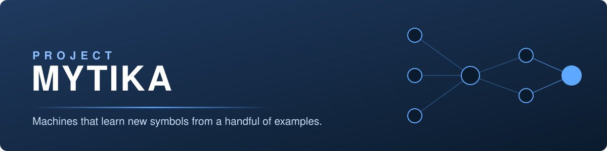
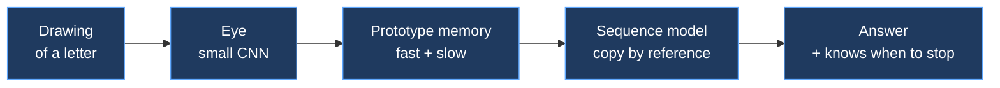

  

  
  
  
  

<h3 align="center">We build and measure learners that pick up new symbols from a few examples, without forgetting the old ones.</h3>

Small models · few-shot learning · evidence first

---

## What we do

Most small neural networks memorise what they were shown and break on anything slightly new: a letter they have not seen, a string a little longer than their training data. We study that failure in a controlled setting, find what fixes it, and measure every claim against held-out tests, controls and repeated seeds.

| | |
|---|---|
| **Learn new symbols from 1-3 examples** | A fast prototype memory adds a symbol without retraining the network, and a slower rehearsal keeps old symbols intact. |
| **Apply a learned rule to symbols never trained on** | Copy-by-reference over perceptual vectors transfers a rule (copy, reverse) to letters the model has only just been shown. |
| **Know when to stop** | Most of the "length limit" turned out to be a stopping error, not a copying error, and is repaired in large part by giving the model something to point at when it should end. |
| **Test honestly** | Held-out items, shuffled controls, paired statistics, and negative results kept on the record. |

## Flagship: Mark 1.1 *(technology preview)*

A small transformer (about 112 thousand parameters, random start) and a small picture-reading network, studied end to end. Selected measured results (synthetic letter tasks, unseen fonts, held-out letters never used in a lesson):

| What was tested | Before | After |
|---|---|---|
| Copying **held-out letters** (10 seeds) | 0.30 | **0.67** |
| New letter from **one drawing**, then **three** | n/a | 0.61, then 0.81 |
| **Old letters kept** after learning new ones | 0.00 (plain fine-tuning) | **0.86** |
| Strings **one symbol longer** than any trained | 0.28 | **0.54** |
| Reading **unseen words** aloud, per phoneme | 0.23 (shuffled control) | 0.72 |

Exact-match accuracy of the whole answer. The sequence-model result is limited by the eye (it names those letters 0.84 of the time). Details are in the technical report, available under agreement.

## What is proven, and what is not

| We can show | We do **not** claim |
|---|---|
| Measured gains on controlled letter and word tasks, repeated over 10 seeds with held-out items | Performance on real handwriting, real documents or real products |
| What did *not* help: scheduling, curiosity, replay, listening stages, twelve architectural priors | A "child-like brain", general intelligence or readiness for production |
| A reproducible test suite and a method for checking generalisation | That the techniques are new in every part. Each builds on published work, which we cite |

## Where it could apply

On-device recognisers that learn a new character or symbol from a few examples · tools that must handle rare symbols and identifiers · evaluation of generalisation in small models. These are directions, not shipped products.

## Roadmap

- [x] Controlled study, report, test suite, two live demo tools
- [ ] Validate on **real handwriting** and one real copying task
- [ ] Rebuild the training images from **openly licensed fonts**
- [ ] Package as an installable library with a reproducible benchmark
- [ ] Learned exploration (research track, separate from Mark 1.1)

## Work with us

Mark 1.1 is **proprietary**. There is no free trial or evaluation licence; access is by written agreement.

- **Commercial licence** for use in a product or service
- **Paid pilot**, time-limited, under a signed agreement
- **Technical hand-over** of code and reports
- **Supervised live demo** and the technical report, under an NDA

**Contact:** rhydham937@gmail.com

## How we work

Evidence before claims. Every number in our reports is generated from raw results by code, not typed by hand; weak results and mistakes are written down, including our own bugs. Engineering is AI-assisted and human-directed, and we say so.

---

Project Mytika · research prototype · repositories are private

